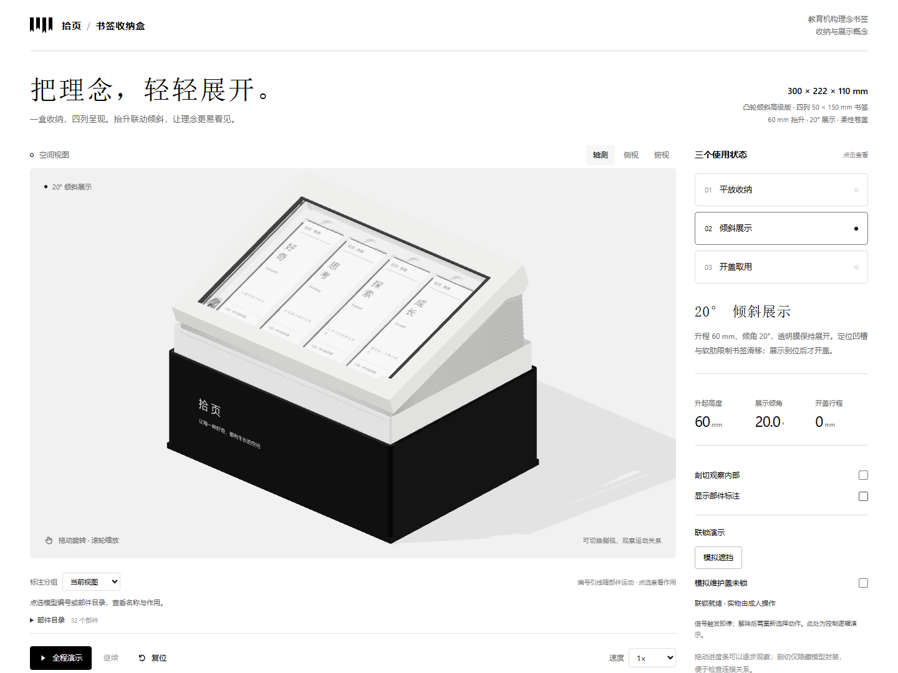

# 书签收纳盒 · 凸轮倾斜高级版

面向教育机构理念宣传书签的黑白极简展示盒。使用交互式三维模型演示平放收纳、抬升倾斜展示和开盖取用，提供部件编号、内部剖切、动作进度与联锁演示。



## 打开设计

下载仓库后，用支持 WebGL 的现代浏览器直接打开 [书签收纳盒-凸轮倾斜高级版.html](书签收纳盒-凸轮倾斜高级版.html)。高级版 HTML 已内嵌三维库与代码，可离线运行，无需安装依赖或启动服务器。

- 点击三个状态按钮或“全程演示”观看动作；进度条可逐步检查中间姿态。
- 拖动模型旋转，滚轮缩放；切换轴测、侧视与俯视观察结构。
- 勾选“剖切观察内部”检查支承与传动，勾选“显示部件标注”查看编号引线。
- 点选模型编号或部件目录，查看名称与用途。31号黑色滑套沿固定导杆引导车架；附着在滑套侧面的32号灰色连接臂将其连接到竖车架并传递侧向力。14号丝杠螺母负责驱动车架升降。
- “模拟遮挡”与“模拟维护盖未锁”用于演示停机和重新发起动作的逻辑。

其他页面：[基础紧凑防护版](书签收纳盒-紧凑防护版.html)、[高级版方案评审](高级版-方案评审.html)。根目录的 `index.html` 是基础版入口。

## 规格与动作

| 项目 | 示例设计参数 |
| --- | --- |
| 闭合箱体 | 300 × 222 × 110 mm，脚垫外露1 mm |
| 书签 | 50 × 150 mm，四列；示例堆厚每列不超过3 mm |
| 定位槽 | 每槽52 × 152 × 4 mm，保留2 mm连续槽底 |
| 承托盒升程 | 60 mm |
| 展示倾角 | 20°，由固定凸轮槽确定 |
| 卷盖行程 | 184 mm |
| 柔性盖候选 | 0.30 mm TPU膜，卷芯半径14 mm |

| 使用状态 | 动作与状态 |
| --- | --- |
| 平放收纳 | 承托盒水平收入箱体，柔性盖覆盖书签 |
| 倾斜展示 | 前18 mm水平抬升避开箱口，余下42 mm边升边倾至20° |
| 开盖取用 | 升降、倾斜到位后，将膜经后导辊收进卷盒；机构停稳后取用 |

复位顺序为先闭盖，再按相同槽曲线回平并下降。进度条调节的是动作进程，实体方案没有独立倾角执行器。

## 结构设计

一台升降电机通过底部同步带驱动左右梯形丝杠。丝杠上下支承固定在底板与侧脊板上；螺母、导向滑套和车架保持竖直运动。前侧同轴双耳轴允许承托模块倾斜，65 mm曲柄上的Ø10滚轮沿固定封闭凸轮槽运行。主槽负责确定倾角，副槽留有较大间隙，作为倾斜防翻落备份，避免两侧重复精定位。

后导向连接臂与车架之间设6 × 9 × 6 mm短承接段，补齐原模型的5 mm断口，并与两端实体搭接，形成车架—连接臂—滑套—固定导杆的侧向承力路径。

承托盒、膜、卷盖电机、同步带、导辊和卷盒整体倾斜，保持模块内部膜路相对位置。定位槽的前侧、右侧为基准，后端与左侧一体软肋轻预压，限制书签在斜面上滑移；后端盲指槽便于取纸。

竖直裙罩、倾斜刚性护罩与四侧连续浅褶罩封装传动。柔性罩的后连接边下移11 mm，后轴承板下部收窄，并以成形接圈、斜接法兰及四角封板保持连接连续。后轴承板凹角与固定支脚根部增加R2过渡，车架主梁、连接块和底脚外边增加C0.3…0.5倒角；这些是待载荷校核的加工候选，详见页面中的机构说明。

柔性盖在模型中降低显示透明度，便于辨识膜面和弯折范围；这一视觉设置不代表材料实测透光率，也不改变膜厚或卷径计算。

## 源文件与构建

高级版交付文件由模板与源文件合成，修改时应编辑源文件，再重新构建。

| 文件 | 用途 |
| --- | --- |
| `ui-template.html`、`scene.js`、`annotations.css` | 页面、交互与标注布局 |
| `advanced-kinematics.js` | 升程、倾角、槽曲线及膜卷几何 |
| `advanced-renderer.js` | 高级版三维构件与运动封装 |
| `advanced-annotations.js` | 编号、部件名称、作用与随动锚点 |
| `advanced-engineering-details.html` | 机构说明、尺寸与验证边界 |
| `lowbox-renderer.js`、`kinematics.js`、`annotations.js` | 基础版及高级版共用几何辅助 |
| `build.cjs`、`build-advanced.cjs` | 生成基础版、高级版HTML |
| `assets/three.min.js` | 本地内嵌三维库 |

安装 Node.js 后，在仓库根目录运行：

```sh
node build.cjs
node build-advanced.cjs
```

高级版构建生成 `书签收纳盒-凸轮倾斜高级版.html`，同时生成本地调试用的 `advanced-scene.generated.js`。

## 验证

以下脚本使用 Node.js 与仓库内的三维库，不需要另装软件包。部分校核结果写入本地 `output/` 目录，其余输出到终端。

```sh
node verify-kinematics.cjs
node verify-advanced-kinematics.cjs
node verify-advanced-assembly.cjs
node verify-rear-bellows.cjs
```

这些检查覆盖基础运动、高级版槽曲线、选定装配包络，以及实际柔性罩三角面与后部构件的干涉回归。检查范围和指标保留在脚本中，不能据此推断所有零件之间都无干涉。

浏览器验证脚本位于 `tests/browser/`，检查状态按钮、实际三维姿态、标注、窄屏布局、联锁、正反向动画与离线运行。使用 Playwright CLI 时，可在仓库根目录启动8768端口的静态服务器，再按以下方式运行；需已安装 Node.js 和可用的浏览器环境。下面的静态服务器示例还需要 Python。

```sh
python -m http.server 8768 --bind 127.0.0.1
```

在另一个终端中：

```sh
npx --yes --package @playwright/cli playwright-cli -s=bookmark open http://127.0.0.1:8768/
npx --yes --package @playwright/cli playwright-cli -s=bookmark run-code --filename tests/browser/advanced-browser-qa.js
node tests/browser/prepare-motion-qa.cjs
npx --yes --package @playwright/cli playwright-cli -s=bookmark run-code --filename output/advanced-motion-qa.js
```

准备脚本将当前目录的离线HTML地址写入本地临时测试脚本；生成文件位于被Git忽略的 `output/`，仓库源文件不包含个人绝对路径。

## 制造与使用边界

这是用于机构方案评审的交互式设计文件，尚不是可直接加工的零件级CAD。圆角和倒角为加工候选，尚无有限元、接触疲劳或循环寿命试验结果。名义装配间隙需要结合材料厚度、公差、挠曲与磨损复核。

实物深化需确定质量与重心、材料、轴承及导向选型、槽壁与曲柄强度、螺钉防松、驱动余量、线缆弯曲寿命、膜卷偏和柔性罩疲劳。低龄使用还需验证触达、夹持力、停止距离、失电保持、防坠、维护联锁及小件脱落。副槽不能替代升降防坠；网页联锁演示不能证明实物的传感器覆盖或安全控制性能。

## 第三方组件

三维显示使用 Three.js r160，按其MIT许可证提供。许可证全文见 [assets/THREE-LICENSE.txt](assets/THREE-LICENSE.txt)，也已保留于独立高级版HTML中。机构资料的官方参考链接位于设计页面末尾。
